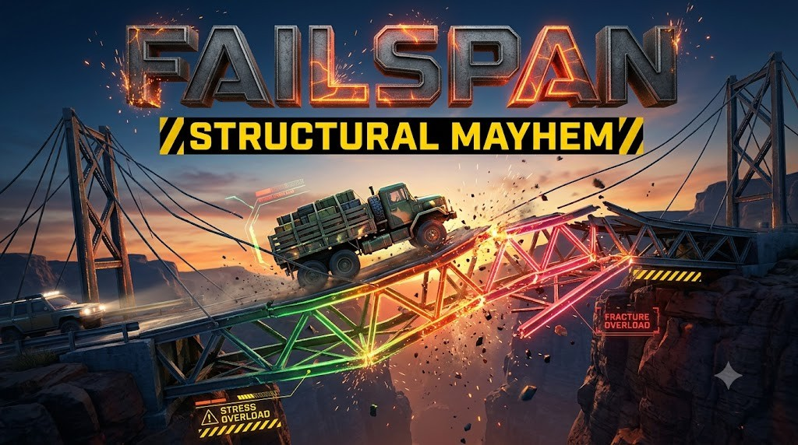

# FAILSPAN: Structural Mayhem

Build. Stress. Snap. A real-physics bridge game for Class 1 to Expert Engineer, grown out of MODIS BridgeWorks Campus.

- Open `index.html` through any local web server (for example `python -m http.server`) and pick **2D** or **3D** on the start screen. The choice is saved; the top-bar button switches any time.
- **2D**: the original BridgeWorks Campus game, unchanged. It never downloads the 3D files.
- **3D** (`js/view3d.js`, Three.js r160 in `vendor/`): 3D campus road with the 16 class buildings, canyon scenes, the player's design as a 3D truss bridge, 3D vehicles, stress glow green -> amber -> red, sparks / debris / slow motion / camera shake when a member fails, and a glass HUD with a live STRESS % meter and FRACTURE IMMINENT warning. Build in 2D (Build (2D) button), and the test drive switches to 3D. "Low graphics" on the start screen is for slow phones.
- The physics is the same truss solver (`js/truss.js`) in both views; `node tests/truss.test.js` checks it.
- Font: Chakra Petch (SIL Open Font License, `vendor/fonts/OFL.txt`).
- `thumbnail.png` (800 x 500) is the Stratos game card; `social-preview.jpg` (1280 x 640) is for GitHub Settings > Social preview.
